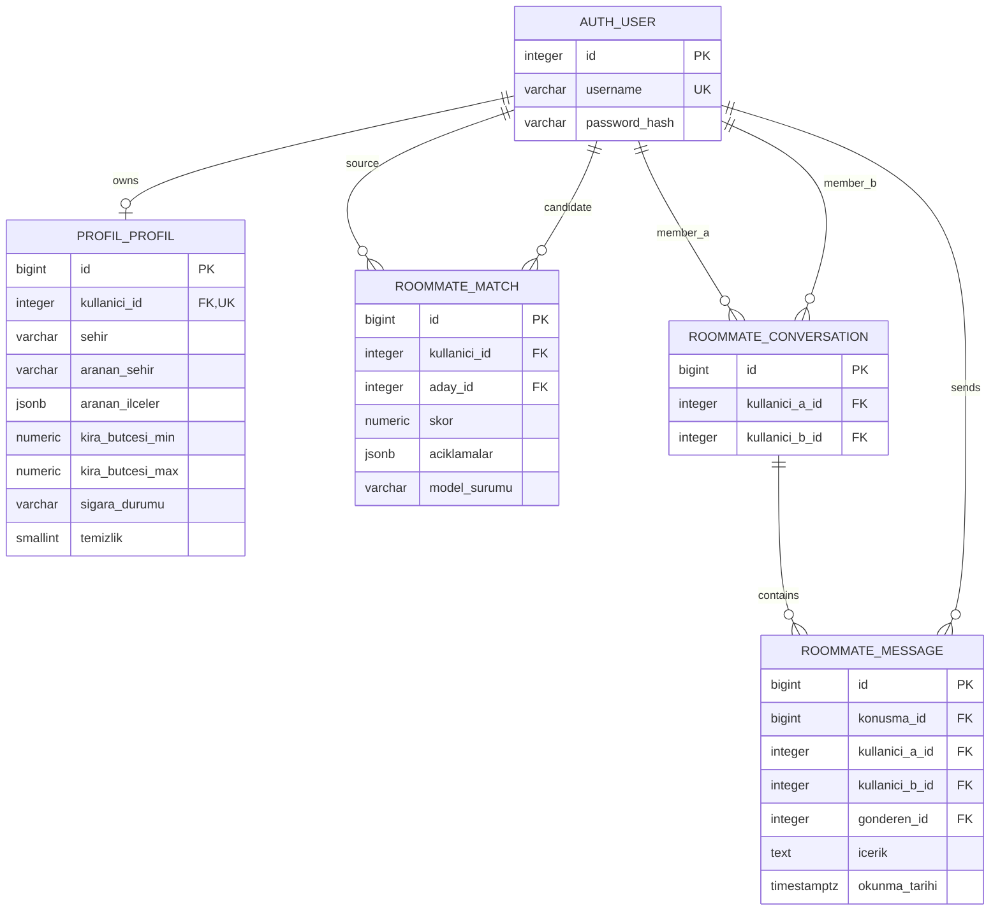

# RoomMate AI — mevcut ilişkiler

Profil kullanıcı ilişkisi bire-birdir. Eşleşme yönlüdür; kaynak-aday çifti benzersizdir, kendi kendine eşleşme olamaz. Konuşmada küçük kullanıcı ID'si a, büyük ID b olur; çift benzersizdir. Mesajın (konusma_id, kullanici_a_id, kullanici_b_id) composite FK'si konuşmayı doğrular; gönderen bu iki kullanıcıdan biridir.

Auth/yetki/session/admin/migration tabloları Django tarafından yönetilir. roommate_* tabloları database/messaging_matches.sql ile eklendi; mevcut backend bunları henüz kullanmaz.
