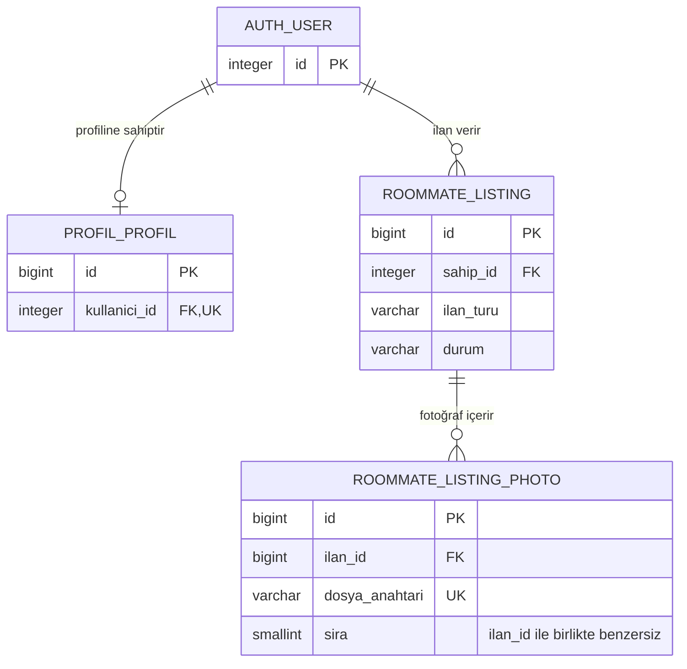

# RoomMate AI ilan şeması — inceleme taslağı

Bu tasarım, React ilan formundaki ev ve oda ilanlarının kalıcı kaydını kapsar. [PostgreSQL DDL taslağı](listing_schema.draft.sql) Yaren ile şema incelemesi içindir. Django ORM ile kullanılacak tablolar için, tasarım onaylandıktan sonra şema yönetiminin Yaren'in Django migration'larında toplanması önerilir.

## `public.roommate_listing`

| Sütun | PostgreSQL tipi | Boş olabilir mi? | Varsayılan ve kurallar |
|---|---|---|---|
| `id` | `bigint` | Hayır | PK, `GENERATED BY DEFAULT AS IDENTITY`. |
| `sahip_id` | `integer` | Hayır | `public.auth_user(id)` FK. Sahip oturumdaki kullanıcıdan atanır. |
| `ilan_turu` | `varchar(3)` | Hayır | `ev` veya `oda`. Oda türüyle birlikte doğrulanır. |
| `baslik` | `varchar(100)` | Hayır | En az bir boşluk dışı karakter. |
| `aciklama` | `varchar(3000)` | Hayır | En az bir boşluk dışı karakter. |
| `sehir_kodu` | `varchar(16)` | Hayır | Küçük ASCII harf, rakam ve arada kısa çizgi. |
| `ilce_kodu` | `varchar(32)` | Hayır | Şehir içinde anlamlı kod. Biçim kuralı şehir koduyla aynı. |
| `oda_turu` | `varchar(24)` | Hayır | `ev` için `studyo`, `1+1`, `2+1`, `3+1`. `oda` için `tek_kisilik`, `paylasimli`. |
| `aylik_kira` | `numeric(10,2)` | Hayır | `0.01`–`99999999.99` TL. Evde toplam, odada kişi başı aylık tutar. |
| `esyali` | `boolean` | Hayır | `true` eşyalı, `false` eşyasız. |
| `alan_m2` | `smallint` | Hayır | `1`–`10000` tam sayı. İlan türüne göre evin veya odanın alanı. |
| `durum` | `varchar(12)` | Hayır | Varsayılan `taslak`. Geçerli değerler `taslak`, `yayinda`, `arsivlendi`. |
| `olusturulma_tarihi` | `timestamptz` | Hayır | Varsayılan `CURRENT_TIMESTAMP`. |
| `guncellenme_tarihi` | `timestamptz` | Hayır | Eklemede `CURRENT_TIMESTAMP`. Sonraki güncellemelerde API yazar. |
| `yayinlanma_tarihi` | `timestamptz` | Evet | Yayındaki ilanlarda zorunlu. Girildiğinde oluşturma tarihinden önce olamaz. |

Konum kodlarının sözlüğü API ile paylaşılmalı. Örneğin `istanbul` ve `kadikoy` kodları kullanıcıya İstanbul ve Kadıköy olarak gösterilebilir. SQL biçimi denetler. Seçilen ilçenin şehre ait olduğunu API ortak sözlük üzerinden doğrular.

## `public.roommate_listing_photo`

| Sütun | PostgreSQL tipi | Boş olabilir mi? | Varsayılan ve kurallar |
|---|---|---|---|
| `id` | `bigint` | Hayır | PK, `GENERATED BY DEFAULT AS IDENTITY`. |
| `ilan_id` | `bigint` | Hayır | `public.roommate_listing(id)` FK. |
| `dosya_anahtari` | `varchar(512)` | Hayır | Depolamadaki nesnenin kalıcı anahtarı. Benzersiz ve boşluk dışı en az bir karakter içerir. |
| `sira` | `smallint` | Hayır | `1`–`5`. `UNIQUE (ilan_id, sira)` ile ilan başına en fazla beş fotoğraf. En düşük sıradaki fotoğraf kapaktır. |
| `alternatif_metin` | `varchar(200)` | Evet | Fotoğrafın erişilebilir açıklaması. |

Taslak ilan sıfır fotoğraf içerebilir. Yayına alma işlemi en az bir fotoğrafı doğrulamalı ve son fotoğrafın yayındaki bir ilandan kaldırılmasını engellemeli. API bu işlemleri aynı ilan satırını kilitleyen transaction'larla yürütürse eşzamanlı yayınlama ve fotoğraf kaldırma işlemleri de bu kuralı korur. Dosya boyutu, MIME türü ve içeriği yükleme sırasında doğrulanır. Depolama URL'si anahtardan üretilir.

## İlişkiler

Her ilan bir kullanıcıya, her fotoğraf bir ilana bağlıdır. Hedef `roommate_ai` veritabanındaki salt okunur kontrolde `public.auth_user.id` tipinin `integer` olduğu ve iki ilan tablosunun henüz bulunmadığı doğrulandı. `sahip_id` bu tipe, `ilan_id` ise yeni ilan tablosundaki `bigint` PK'ye karşılık gelir. Yaren sahip ilişkisini `settings.AUTH_USER_MODEL` üzerinden tanımlayabilir ve model tablo adlarını `Meta.db_table` ile taslağa eşleyebilir.

İki tablonun `bigint` kimlikleri birincil anahtardır. İki FK de `NOT NULL` olduğu için sahipsiz ilan ve ilana bağlı olmayan fotoğraf kaydedilemez. Fotoğrafta benzersiz dosya anahtarı, aynı depolama nesnesinin birden fazla fotoğraf satırında kullanılmasını engeller. Benzersiz `(ilan_id, sira)` ve `1–5` sıra sınırı birlikte ilan başına beş fotoğrafı aşmayı engeller.

İlan `CHECK` kuralları boşluklardan oluşan başlık ve açıklamayı, hatalı konum kodu biçimini, uyumsuz ilan ve oda türünü, sınır dışı kira ve alanı ve geçersiz yayın durumunu reddeder. Yayındaki bir ilanın yayın tarihi zorunludur ve oluşturma tarihinden önce olamaz. Fotoğrafın dosya anahtarı boşluklardan oluşamaz. İlçe ile şehir eşleşmesi ve yayındaki ilanın en az bir fotoğrafının olması API kurallarıdır.

## Silme ve arşivleme

| İşlem | Önerilen Django davranışı | SQL taslağındaki karşılığı |
|---|---|---|
| İlanı yayından kaldırma | `durum = 'arsivlendi'` ile arşivle. İlan ve fotoğrafları sakla. | Durum güncellemesi, FK işlemi yok. |
| İlanı olan hesabı silme | Sahip FK'sinde `on_delete=PROTECT` kullan. Arşivlenmiş ilan da sahibine bağlı kaldığı için hesap silmeden önce ilanların akıbetini belirle. | `ON DELETE RESTRICT` doğrudan SQL ile hesap silinmesini de engeller. `PROTECT`, bu SQL eylemini tek başına üretmez. |
| İlanı fiziksel olarak silme | Fotoğraf FK'sinde `on_delete=CASCADE` kullan ve silmeyi uygulama servisinden yürüt. | Taslaktaki `ON DELETE CASCADE` doğrudan SQL silmesinde de fotoğraf satırlarını kaldırır. Django'nun normal `CASCADE` seçeneği ORM düzeyinde çalışır. |
| Tek fotoğrafı silme | Aynı ilan satırını yayınlama işlemiyle ortak biçimde kilitle. Yayındaki ilanın son fotoğrafını kaldırmadan önce ilanı yayından al veya yerine bir fotoğraf ekle. | Fotoğraftan ilana giden FK, fotoğraf silindiğinde ilanı silmez. En az bir fotoğraf şartını servis denetler. |

İlk sürüm için arşivlemeyi varsayılan kullanıcı işlemi, fiziksel silmeyi ise kontrollü bir servis işlemi olarak öneriyorum. Servis fiziksel silmeden önce ilgili depolama anahtarlarını toplar ve dosya temizliğini transaction başarıyla tamamlandıktan sonra başlatır. Başarısız dosya silme işlemleri yeniden denenebilmelidir. Fotoğraf satırının silinmesi depolama nesnesini kendiliğinden kaldırmaz.

Doğrudan SQL silmelerinde de fotoğraf satırlarının otomatik kaldırılması gerekiyorsa PostgreSQL `ON DELETE CASCADE` davranışı Yaren'in migration'ında açıkça temsil edilmeli. Django 6.1'deki `DB_CASCADE` bu davranışı veritabanına taşır ancak fotoğraf satırları için Django silme sinyallerini göndermez. `DB_*` seçeneklerini ORM tabanlı seçeneklerle birleştirmeden önce Django'nun ilişkili modeller için koyduğu sınırlamalar kontrol edilmeli. Uygulama dışında silme desteklenecekse dosya temizliği yalnız bu sinyallere bağlanmamalı. [Django silme seçenekleri](https://docs.djangoproject.com/en/6.1/ref/models/fields/#django.db.models.ForeignKey.on_delete)

## İndeksler ve filtreleme

| İndeks | Hedef sorgu |
|---|---|
| `roommate_listing_owner_idx` (`sahip_id`) | Hesabın ilanlarını bulma ve kullanıcı FK kontrolü. |
| `rm_listing_pub_order_idx` (`yayinlanma_tarihi DESC, id DESC`) | Yayındaki ilanları en yeni yayın tarihinden başlayarak kararlı biçimde sayfalama. |
| `rm_listing_pub_loc_idx` (`sehir_kodu, ilce_kodu`) | Şehre göre veya şehir ve ilçe birlikte seçildiğinde filtreleme. |
| `rm_listing_pub_rent_idx` (`ilan_turu, aylik_kira`) | Seçilen ilan türündeki minimum ve maksimum aylık kira filtreleri. |

Dört indeks adı Django'nun 30 karakter sınırına uyar. Son üç indeks yalnız `durum = 'yayinda'` satırlarını içerir. Liste sorgusunun bu koşulu karşılaması gerekir. Fotoğraftaki `(ilan_id, sira)` benzersiz indeksi `ilan_id` ile erişimi ve galeri sıralamasını destekler. Django migration'ında aynı sütunlar için gereksiz FK indeksleri oluşmaması için sahip FK'sinin otomatik indeksi ile açık sahip indeksinden biri seçilmeli. Fotoğraf FK'si için de birleşik benzersiz indeks yeterli olduğunda ek tek sütunlu indeks kaldırılabilir. Oda türü için ayrı indeks kararı gerçek sorgu planlarına göre verilir. [Django indeksleri](https://docs.djangoproject.com/en/6.1/ref/models/indexes/) · [Django FK alanları](https://docs.djangoproject.com/en/6.1/ref/models/fields/#foreignkey) · [PostgreSQL kısmi indeksleri](https://www.postgresql.org/docs/18/indexes-partial.html)

## Yaren ile kararlaştırılacak noktalar

- Hesap silme, ilan arşivleme ve fiziksel silme politikası. Doğrudan SQL silme davranışının desteklenip desteklenmeyeceği ve dosya temizliğinin hangi servise ait olacağı.
- Şehir ve ilçe sözlüğünün kaynağı, oda türü kodlarının API karşılıkları ve kira aralığı girildiğinde `ev` veya `oda` seçiminin istenmesi. Bu seçim toplam kira ile kişi başı kirayı ayırır.
- İlk yayın ve yeniden yayın sırasında yayın tarihinin nasıl kullanılacağı, taslakların erişimi ve dosya doğrulaması.
- Yaren'in Django migration'ının oluşturduğu tablo adları, FK eylemleri, varsayılanlar, kısıtlar ve indeksler onaylanan tasarımla karşılaştırılmalı. Ardından ayrı test veritabanında migration ve sorgu planları değerlendirilmeli.
